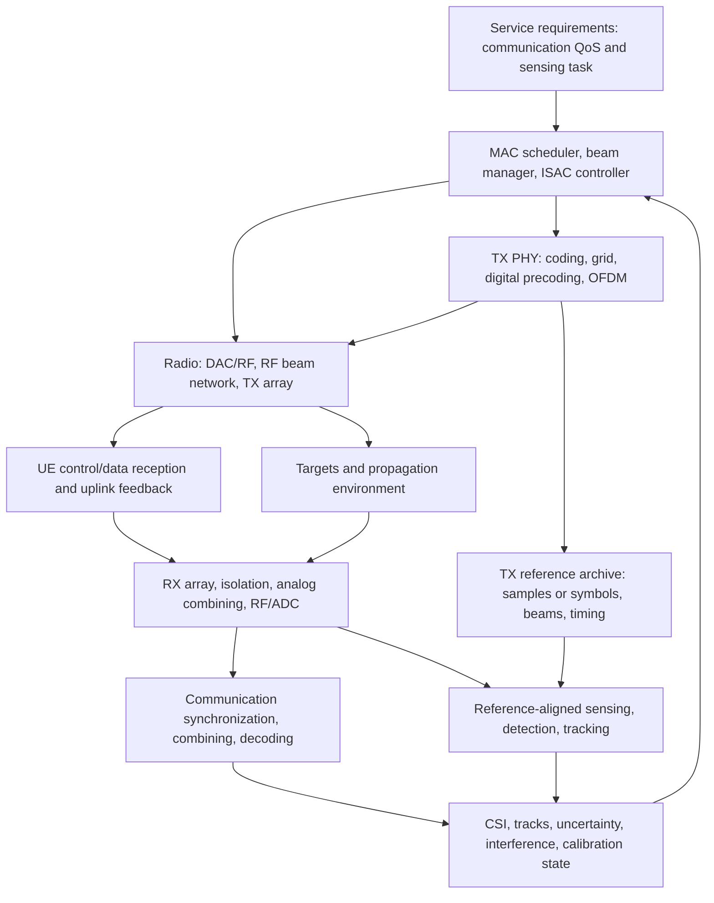
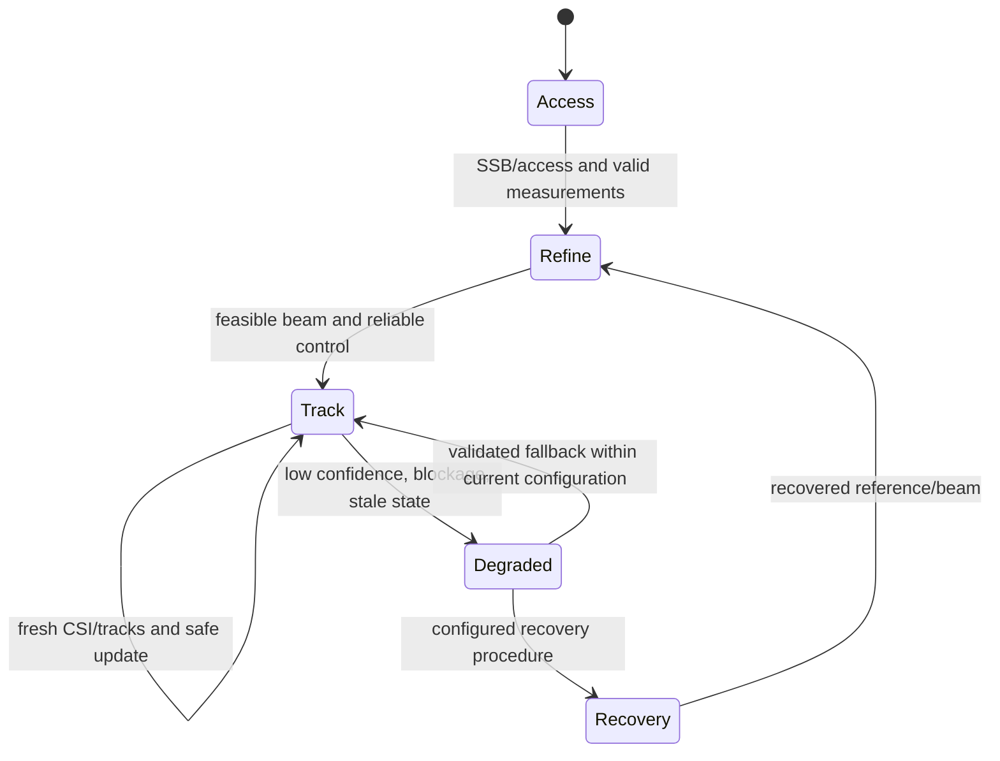
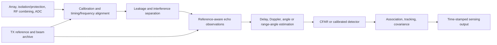
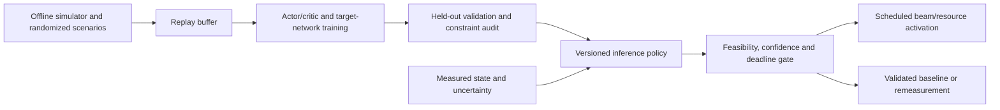
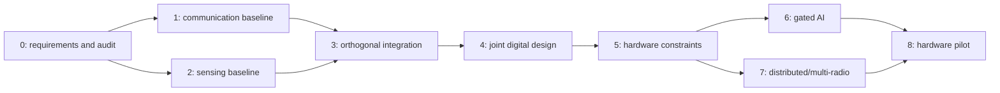

# Beamforming design for 6G integrated sensing and communication

**Design status:** Research-to-prototype reference architecture, updated
12 November 2026.

This document connects radio selection, physical-layer processing, control
reliability, data precoding, waveform design, sensing DSP, and closed-loop
resource allocation. It specifies a phased implementation and evaluation
procedure rather than claiming a finished 6G product. Source-reported results,
engineering corrections, and new design proposals are identified separately.

**NOTE**: No new simulation results or hardware measurements are claimed.

## Contents

- [How to use this guide](#how-to-use-this-guide)
1. [Design intent and evidence](#1-design-intent-and-evidence)
2. [Requirements and operating modes](#2-requirements-and-operating-modes)
3. [Radio families and physical constraints](#3-radio-families-and-physical-constraints)
4. [End-to-end architecture and ownership](#4-end-to-end-architecture-and-ownership)
5. [Physical-layer signal and beam models](#5-physical-layer-signal-and-beam-models)
6. [Control-channel and beam-management design](#6-control-channel-and-beam-management-design)
7. [Data-channel design and communication DSP](#7-data-channel-design-and-communication-dsp)
8. [Waveform and resource-grid design](#8-waveform-and-resource-grid-design)
9. [Sensing receiver and estimation pipeline](#9-sensing-receiver-and-estimation-pipeline)
10. [Joint optimization and intelligent beamforming](#10-joint-optimization-and-intelligent-beamforming)
11. [Implementation proposals and phases](#11-implementation-proposals-and-phases)
12. [Simulation and measurement procedure](#12-simulation-and-measurement-procedure)
13. [Challenges, mitigations, and trade-offs](#13-challenges-mitigations-and-trade-offs)
14. [Complete PDF figure register](#14-complete-pdf-figure-register)
15. [Source results and reproducibility issues](#15-source-results-and-reproducibility-issues)
16. [Standards and references](#16-standards-and-references)
17. [Disclaimer](#17-disclaimer)

## How to use this guide?

Read sections 1-3 to understand the evidence, requirements, and radio choices.
Sections 4-9 follow the system from architecture and signal models through
communication and sensing processing. Sections 10-11 cover optimization and
an implementation path; section 12 defines how to evaluate it. Sections
13-17 collect trade-offs, source-figure and result audits, references, and
limitations.

For a first prototype, define measurable requirements in section 2, build
communication and sensing baselines before joint optimization, and use the
phase gates in section 11 with the evaluation procedure in section 12. Treat
source-reported results as evidence to assess, not as guaranteed performance;
proposals and corrections are explicitly distinguished throughout.

## 1. Design intent and evidence

### 1.1 What beamforming must accomplish

Integrated sensing and communication (ISAC) shares some combination of spectrum,
waveforms, antennas, RF hardware, and processing between communication and
environment sensing. Sharing hardware alone is not the same as using one
joint waveform; both are legitimate integration levels.

Beamforming controls where transmitted energy goes and which spatial
observations reach the receiver. In an ISAC system it must simultaneously
support reliable access/control, useful data throughput, target illumination,
echo observability, and interference containment. A throughput-optimal beam
can miss an object; a narrow sensing beam can break control coverage; an analog
receive combiner can discard the spatial samples needed for angle estimation.
These are coupled design problems, not independent beam-index selections.

**Recommended starting design:** protect communication control first; use
NR-like CP-OFDM data and known-reference sensing in scheduled opportunities;
establish calibrated digital beamforming as the algorithmic benchmark; then
introduce hardware-constrained hybrid beamforming, range-angle focusing, and
bounded AI assistance only when justified by measurements. mmWave is useful,
but not a prerequisite for ISAC.

### 1.2 Source register

References `[S1]` through `[S4]` below refer to the repository PDFs. Page numbers
are **PDF page numbers**, including the first page, not section numbers.
The later figure register accounts for all **25 numbered figures**, including
their subpanels, and the results section covers all **eight numbered tables**.
The diagrams in this guide are original explanatory schematics, not copies of
the papers' figures or regenerated experimental curves.

| ID | Repository source | Design contribution | Evidence boundary |
| --- | --- | --- | --- |
| S1 | [Aman et al., *AI-driven dynamic resource allocation for ISAC systems in 6G networks: intelligent beamforming, interference management, and power allocation*](AI-driven%20dynamic%20resource%20allocation%20for%20ISAC.pdf), Scientific Reports, 2026, 24 pages | DDPG resource control using communication, sensing, energy, and interference objectives; urban, dense-city, and rural scenarios | Broad architecture and reported comparisons; missing implementation details and inconsistent numerical presentations prevent treating the gains as verified targets |
| S2 | [Feng et al., *Beamforming optimization for ISAC interference suppression via range-domain design in mixed near/far-field scenarios*](Beamforming%20optimization%20for%20ISAC.pdf), Complex & Intelligent Systems, 2026, 11 pages | Range-angle steering, curvature-mismatch interference suppression, WMMSE/SOCP optimization | Useful mathematical benchmark; field-boundary and radar-SINR inconsistencies require correction before reproduction |
| S3 | [Dao et al., *Dynamic Beamforming and Power Allocation in ISAC via Deep Reinforcement Learning*](Dynamic_Beamforming_with_ISAC.pdf), arXiv:2510.25496v1, 2025, 7 pages | Dynamic continuous-action DDPG, separate TX/RX arrays, receive combining, SDR/DQN runtime comparison | Narrowband, known-CSI/target-state benchmark; not a complete wideband sensing estimator or real-time NR implementation |
| S4 | [Mukhiddinov et al., *Optimized 6G ISAC Beamforming for Target Detection and Localization*](Optimized%206G%20ISAC%20Beamforming.pdf), IPIN-WCAL 2025, 8 pages | LFM/FMCW, pulse compression, fixed-angle beamforming, OFDM integration, localization/BER evaluation | Illustrative MATLAB study; waveform units, caption mismatches, and insufficient joint-channel detail need explicit treatment |

The source PDFs do not specify a complete interoperable control/data-channel
ISAC protocol. Sections 4-12 supply an engineering design that connects their
ideas to existing NR mechanisms; those additions are **proposals**, not features
proven by the papers.

### 1.3 Terminology and standardization boundary

**cWave means centimetric-wave radio here**, following the requested scope:
approximately 3-30 GHz, with wavelength 10-1 cm. It does not mean only C-band,
and it does not mean continuous-wave radar. C-band is commonly 4-8 GHz under
one widely used naming convention; band labels vary by application. CW/FMCW
describe waveforms, independent of the carrier family.

The mathematical mmWave interval is 30-300 GHz. Industry often also calls
28 GHz cellular equipment "mmWave"; this guide makes that convention explicit.
"Sub-6 GHz," NR FR1/FR2, centimetric wave, and mmWave are not interchangeable
frequency classifications.

| Abbreviation | Meaning |
| --- | --- |
| ADC / DAC; PA / LNA | Analog-to-digital / digital-to-analog conversion; power amplifier / low-noise amplifier |
| PHY / DSP / MAC / RRC | Physical layer / digital signal processing / medium access control / radio resource control |
| gNB / UE / AP | NR base station / user equipment / access point |
| MIMO / RF; ULA / UPA / UCA | Multiple-input multiple-output / radio frequency; uniform linear / planar / circular array |
| CSI / CSI-RS / SRS | Channel state information / downlink CSI reference signal / uplink sounding reference signal |
| SSB / DM-RS / PT-RS | Synchronization signal block / demodulation reference signal / phase-tracking reference signal |
| PDCCH / PDSCH | Physical downlink control channel / physical downlink shared channel |
| PUCCH / PUSCH / PRACH | Physical uplink control channel / shared channel / random-access channel |
| TCI / QCL; HARQ / BLER | Transmission configuration indicator / quasi-co-location; hybrid automatic repeat request / block error rate |
| CP-OFDM / DFT-s-OFDM | Cyclic-prefix OFDM / DFT-spread OFDM |
| CW / FMCW / LFM | Continuous wave / frequency-modulated continuous wave / linear frequency modulation |
| SINR / SCNR; RCS | Signal-to-interference-plus-noise / signal-to-clutter-plus-noise ratio; radar cross section |
| FIM / CRLB; CFAR | Fisher information matrix / Cramer-Rao lower bound; constant false-alarm rate detection |
| WMMSE / SCA / SOCP / SDR | Weighted minimum mean-square error / successive convex approximation / second-order cone program / semidefinite relaxation |
| DRL / DDPG / DQN | Deep reinforcement learning / deep deterministic policy gradient / deep Q-network |
| TTD / CPI; EIRP / EVM | True time delay / coherent processing interval; equivalent isotropically radiated power / error vector magnitude |

ITU IMT-2030 supplies a 6G framework including ISAC. Existing 3GPP NR
specifications supply physical channels and beam-management procedures.
Neither a framework nor an ISAC study automatically standardizes a proposed
sensing waveform, report, scheduler API, or simultaneous TX/RX implementation.
Authoritative standards sites could not be reached during this update;
references in section 16 are verification pointers, not a claim that the
latest November 2026 release status was checked. Pin exact specification
versions before implementation or compliance review.

## 2. Requirements and operating modes

### 2.1 Turn an application into measurable requirements

The project must select a deployment envelope before choosing its radio or
optimizer. Record user/target geometry, mobility, clutter, RCS distribution,
coverage, traffic, permitted spectrum, hardware, and sensing purpose.
Examples below are **proposed prototype targets**, not 6G mandates.

| Requirement | Design variable | Acceptance evidence |
| --- | --- | --- |
| R1: control remains reachable during sensing | Control resources, beam state, repetition/aggregation policy, fallback beam | Control BLER/outage and recovery-time distributions with sensing on/off, including blockage |
| R2: data QoS and fairness are maintained | User selection, MCS, layers, precoder, sensing overhead | Goodput, per-user outage, BLER, latency tails, and fifth-percentile user performance |
| R3: targets are observable | Illuminated region, bandwidth, CPI, receive spatial sampling | Detection probability at specified false-alarm probability; range/angle/velocity errors and missed tracks |
| R4: decisions remain timely | Estimation age, transport, optimization, beam-switch latency | End-to-end deadline-miss probability, not inference time alone |
| R5: the radio stays feasible | RF-chain count, phase resolution, per-element power, EIRP, ADC headroom | Implementable weights, clipping rate, EVM, spectral emissions, thermal and DC-power measurements |
| R6: distributed observations can be fused | Clock/position calibration, timestamping, AP geometry, backhaul | Clock-bias residuals, geometry-conditioned localization error, fusion delay |
| R7: operation is traceable and privacy-aware | Measurement retention, access control, model/version provenance | Reproducible logs, approved sensing regions/purposes, retention and authorization controls |

A first controlled monostatic profile might target nominal range resolution
of 1.5 m using 100 MHz occupied bandwidth, sensing updates every 20 ms, and
a specified PDCCH reliability budget. Resolution is not measurement RMSE.
Set detection range only after an echo link budget; set control BLER and
sensing false-alarm thresholds according to the application.

### 2.2 Integration modes

| Mode | Implementation | Main advantage | Main limitation |
| --- | --- | --- | --- |
| Separate resources/hardware | Dedicated radar and communication resources with information exchange | Lowest waveform coupling; useful baseline | Extra equipment/spectrum and weaker resource reuse |
| Time/frequency-orthogonal sharing | Scheduled sensing bursts or reserved subbands on a shared platform | Easier interference isolation and rollback | Lost communication resources; sensing sampling gaps |
| Spatial sharing | Separate communication and sensing beams on shared time-frequency resources | Concurrent operation where geometry permits | Finite spatial degrees of freedom, sidelobes, RF constraints |
| Communication-centric reuse | Echo processing of known OFDM/reference/data transmissions | Smallest air-interface change | Irregular grids, data knowledge, beam coverage, and dynamic range constrain sensing |
| Joint waveform/beam optimization | Design symbols, covariance, beams, and resources together | Potentially better Pareto frontier | Higher complexity, receiver changes, and interoperability risk |
| Collaborative/networked ISAC | Multiple nodes exchange observations and coordinate beams/resources | Better geometry, coverage, and blockage resilience | Synchronization, fronthaul/backhaul, calibration, and privacy cost |

This progression reflects resource-separated, orthogonal, converged, and
collaborative concepts discussed in S1, pp. 2-4. They are integration choices,
not a mandated maturity ladder.

Monostatic sensing uses the same site for TX and RX; bistatic uses different
sites; multistatic uses multiple paths/sites. Separate TX/RX arrays at one
site still require isolation and calibration. Ordinary TDD operation does
not inherently provide simultaneous echo reception during a downlink burst.

## 3. Radio families and physical constraints

### 3.1 Carrier and platform selection

| Radio family/platform | Beamforming opportunity | ISAC constraints | Practical starting choice |
| --- | --- | --- | --- |
| Sub-GHz/low-band radios | Coverage, diffraction, and long observation reach in suitable environments | Large wavelength requires a physically large aperture for fine angle discrimination; often restricted bandwidth limits delay resolution | Modest digital arrays or switched antennas; use for access/coarse sensing rather than assume fine localization |
| Decimetric/low microwave, roughly 1-3 GHz | Relatively robust communication and distributed coverage | Compact arrays have limited directivity; rich multipath/clutter complicates passive-object interpretation | Calibrated digital MIMO and cooperative fusion where appropriate |
| Centimetric wave, roughly 3-30 GHz, including C-band and upper-mid-band | Mature components, useful bandwidth/aperture balance, digital multi-user flexibility | Large arrays may already be near-field; bandwidth, coexistence, coupling, and feedback overhead remain limiting | Digital or subarray hybrid beamforming; evaluate range-angle focusing on actual aperture/geometry |
| mmWave, 30-300 GHz, plus industry-labeled 28 GHz systems | Compact large-element arrays, narrow beams, potentially wide bandwidth | Blockage, beam training, phase noise, PA efficiency, beam squint, calibration drift, and converter power | Hybrid phase-shifter/subarray beamforming; frequency-aware digital weights or TTD when required |
| Sub-THz, commonly about 100-300 GHz, overlapping mmWave | Very wide bandwidth and short wavelength for fine spatial/delay resolution | Band-dependent atmospheric attenuation, low RF output, high sampling cost, severe phase noise and near-field effects | Short-range research prototype, reduced RF chains, subband/TTD focusing, explicit power and link budgets |
| THz, about 0.3-3 THz in this guide | Extremely compact apertures and potentially very high bandwidth | Immature radios, propagation windows, absorption, packaging, converter and synchronization limits | Research extension only; do not extrapolate cmWave/mmWave simulation gains |
| WLAN/private/industrial radios | Existing OFDM infrastructure for local sensing/communication | Unlicensed coexistence, asynchronous packets, unavailable TX data at passive receivers, device calibration | Packet/reference-based sensing with measured timing and interference models |
| Distributed/cell-free arrays | Spatial diversity, bistatic geometry, cooperative nulling and localization | Clock/phase coherence, AP-position error, backhaul, waveform identifiability | Noncoherent track/measurement fusion first; coherent joint beams only after calibration |
| UE/handheld radios | Mobile beam tracking and potential cooperative sensing | Small aperture, body blockage, orientation changes, battery/thermal limits, limited RF chains | Codebook/hybrid operation and confidence-aware reporting |
| UAV/HAPS/non-terrestrial radios | Coverage diversity and additional sensing geometry | Platform motion, pointing jitter, long delay, Doppler, payload energy, backhaul and geometry uncertainty | Platform-aware tracking and hierarchical coordination; separately validate the channel model |

Carrier families and platform rows overlap: a UAV can use centimetric-wave
or mmWave radio. Optical/visible-light links are not RF beamforming systems;
they may provide auxiliary localization but require a separate physical model.
S1 surveys RIS, OTFS, UAV/HAPS, edge processing, and cell-free extensions;
it does not experimentally validate all these radio configurations.

**C-band is not synonymous with all cWave radios.** At 6 GHz the wavelength is
about 5 cm; at 10 GHz it is 3 cm; at 28 GHz it is about 1.07 cm. A 77 GHz
FMCW radar, as in S4, has wavelength about 3.9 mm and is a mmWave radio.
Pure CW measures Doppler but does not generally resolve absolute range
without added modulation, multi-frequency observations, or other information.

### 3.2 Aperture, gain, and field region

For carrier frequency `f_c`, wavelength `lambda = c/f_c`, and maximum aperture
dimension `D`, a conventional far-field transition estimate is:

```text
Rayleigh distance: R_R = 2 D^2 / lambda
ULA aperture:      D = (N_ant - 1) d
Angular scale:     beamwidth is of order lambda / D
```

The boundary is approximate, not a switch in physical propagation. Very close
to an antenna, reactive-field effects need an electromagnetic model; a
spherical-wave propagation model alone is not sufficient. Use exact element
distances through the Fresnel/Fraunhofer transition and check element patterns,
coupling, and amplitude variation.

**Fixed aperture versus fixed element count matters.** At fixed aperture,
higher frequency permits more elements and finer angular resolution, and
`R_R` increases as wavelength decreases. At fixed half-wavelength-spaced
element count, aperture shrinks with wavelength, so `R_R` decreases. Avoid
the blanket claim that every higher-frequency array has a larger near field.

| Illustrative half-wavelength ULA | Approximate aperture | Approximate `R_R` | Design implication |
| --- | --- | --- | --- |
| 64 elements, 6 GHz | 1.58 m | 99 m | Many indoor/short-range users require range-angle rather than angle-only modeling |
| 64 elements, 28 GHz | 0.337 m | 21 m | Nearby users may need focusing; farther users can be approximately far-field |
| 256 elements, 10 GHz | 3.82 m | 975 m | S2's 15-25 m users are near-field, but its 500 m target is not safely far-field under this criterion |
| 16 elements, 77 GHz | 0.0292 m | 0.438 m | S4's small ULA is usually far-field at meter-scale ranges; a larger aperture changes this |

These are calculations from the stated geometry, not measured coverage.
S2 reports about 122 m for its 256-element 10 GHz configuration; that value
does not follow from its stated half-wavelength spacing. Keep the range-domain
principle, but correct the geometry before relying on the mixed-field results.

At fixed conducted power, an ideal coherent array provides array gain, but
normalization, element gain, EIRP limits, and receive aperture must all be
specified. A two-way radar echo also depends on RCS and typically decays
as `R^-4` in an ideal monostatic far-field model. Communication reach is not
the same as sensing reach. Do not apply that radar law unchanged in the
near-field or bistatic geometries.

### 3.3 Hardware architectures

| Architecture | Spatial flexibility | Cost/constraint | ISAC consequence |
| --- | --- | --- | --- |
| Analog phase-shifter array | Usually one or a few constrained beam patterns | Few RF chains; frequency-flat phase settings, quantization, insertion loss | Low hardware cost, but limited simultaneous beams and discarded receive spatial information |
| Fully digital array | Per-chain/subcarrier complex weights and flexible combining | Converters, transport, computation, and DC power scale with active chains/bandwidth | Best benchmark for joint multi-user/sensing processing; not automatically the most energy-efficient implementation |
| Hybrid fully connected | Each RF chain connects to many/all elements | Flexible but lossy and complex RF network | Approximate digital solutions subject to constant-modulus and RF-chain constraints |
| Hybrid subarray | Each RF chain drives a subset of elements | Lower connectivity/cost; reduced spatial degrees of freedom | Useful prototype compromise; evaluate subarray sidelobes and scan loss |
| TTD-assisted array | Delay steering better aligns wideband signals | Delay range/resolution, insertion loss, cost, and calibration | Mitigates beam squint; near-field focusing may need non-linear element-delay profiles |
| Reconfigurable surface/lens/large-aperture research radio | Extra propagation control or beam selection | Surface-state overhead, passive loss, hardware dispersion, difficult joint calibration | Treat as an optional modeled extension, not free gain or a replacement for a receiver |

The number of independently multiplexed streams is bounded by RF chains
and effective channel rank. A single stream can have a multi-lobed pattern,
but that does not create independent data/sensing streams. Orthogonal sensing
codes can improve identifiability while consuming waveform degrees of freedom.

## 4. End-to-end architecture and ownership

### 4.1 Functional architecture



**Figure D1 - Functional ISAC loop.** Downlink transmission reaches both users
and objects; uplink signals and echoes enter calibrated receive processing.
Sensing uses the actual transmitted reference and beam history. The arrows
denote information/signal paths, not a guarantee of concurrent duplexing.
This original schematic combines the architecture concepts in S1 Fig. 1,
S2 Fig. 1, and S3 Figs. 1-2.

### 4.2 Interfaces and ownership

| Function | Owns | Exposes/receives |
| --- | --- | --- |
| Communication PHY | CSI estimation, effective-channel processing, digital precoding/combining, coding and modulation | Timestamped CSI quality, rank/candidate precoders, interference estimates, decoding outcomes |
| Radio/array controller | RF beam settings, switching, gain, calibration, front-end protection | Feasible codebook/phase/delay states, switch time, headroom, temperature, calibration validity |
| Sensing PHY/DSP | Reference alignment, echo extraction, detection and parameter estimates | Timestamped detections/tracks, uncertainty/covariance, confidence, clutter and leakage indicators |
| Beam manager/joint optimizer | Candidate selection or weight computation under joint constraints | Feasible beams, predicted utility, constraint margins, validity interval and computation status |
| MAC scheduler | User/resources/MCS decisions and communication timing obligations | Reserved control resources, data/sensing allocations, priority and beam-compatibility constraints |
| ISAC service/controller | Sensing purpose, region, dwell/revisit requirements, policy | Approved task, sensing budgets, degradation policy, track-consumer interface |

This is a **proposed vendor-internal contract**, not a standardized interface.
Separate fast local PHY/radio actions from slower controller optimization.
Do not transfer every antenna coefficient through the MAC interface unless
the architecture actually requires it.

A measurement record needs timestamp, coordinate frame, source/node ID,
beam/reference ID, calibration version, uncertainty, and validity interval.
A command needs activation time, resource mask, beam state, permitted power,
expected dwell, and fallback state. Report infeasibility, stale inputs,
deadline misses, and clipping explicitly; never substitute an unchecked beam
and report success.

The TX archive should retain enough information to reconstruct the sensing
reference: symbols or samples, occupied grid, carrier/numerology, TX timing,
digital and RF weights, power normalization, and calibration. Protect payload
data and minimize retention; reconstruction requirements do not justify
unrestricted capture.

### 4.3 Timing budget

```text
measurement timestamp
    | estimation | report/transport | optimization | scheduling | RF switch |
    +--------------------------------------------------------------------> activation
                    total state age at beam activation
```

**Figure D2 - Beam-decision age.** All stages contribute to channel/target
aging. The beam is valid only if its activation-time uncertainty is acceptable.
Precomputed codebooks and local tracking can decouple slow optimization from
fast PHY operation.

For transverse target/user speed `v_perp`, range `R`, and total age `T_age`,
small-angle drift is approximately `v_perp T_age/R` radians. Compare this with
beamwidth and tracking uncertainty, not just a mean runtime. A narrowband
fading heuristic `T_c ~ 0.423/f_D` can flag fast aging, but directional channel
coherence and beam coherence differ and must be measured.

S3's reported roughly 20 ms decision time is a platform-specific benchmark;
it is not evidence that the whole loop fits a 20 ms frame or a sub-millisecond
PHY deadline.

## 5. Physical-layer signal and beam models

### 5.1 Consistent hybrid transmit model

For subcarrier `k`, OFDM symbol `m`, `L` streams, `N_RF` RF chains, and
`N_ant` elements:

```text
s[k,m]      : L x 1 symbols, with defined covariance R_s
F_BB[k,m]   : N_RF x L digital precoder
F_RF[k]     : N_ant x N_RF RF-network response
x_RF[k,m]   = F_BB[k,m] s[k,m]
x_ant[k,m]  = F_RF[k] F_BB[k,m] s[k,m]
Q[k,m]      = E{x_ant[k,m] x_ant[k,m]^H}
```

`H` denotes conjugate transpose. In phase-shifter hardware the programmable
RF state is often shared across subcarriers, even though its **physical**
response is frequency-dependent. TTD introduces a frequency-dependent phase
through delay. Element patterns, coupling, gain drift, and nonlinearity need
additional modeling beyond this linear abstraction.

```text
L streams -> F_BB[k,m] -> N_RF streams -> IFFT/CP/DAC/RF
                                            |
                              F_RF network and element PAs
                                            |
                                      N_ant elements
```

**Figure D3 - Hybrid precoding dimensions.** Digital weights act on streams
before per-chain OFDM conversion; the RF network distributes/combines analog
signals across elements. Actual PA/network order depends on radio topology.
The formula is a frequency-domain equivalent, not a claim that RF beamforming
operates on individual OFDM subcarriers in hardware.

Impose constraints on the **effective element covariance**, not merely
individual stream norms:

```text
sum over occupied resources of weighted tr(Q[k,m]) <= power budget
[Q[k,m]]_n,n <= element-n average power limit
RF phase/delay states belong to the implemented hardware set
peak power, EIRP, spectral mask, switching and thermal limits also hold
```

Define resource weights, duty cycle, and whether the budget is instantaneous
or time-averaged. Frobenius normalization is useful for total average power,
but cannot alone guarantee per-element, peak, or RF-state feasibility.

### 5.2 Communication and sensing streams

A narrowband joint benchmark, used conceptually in S2 and S3, is:

```text
x = sum_u w_u d_u + w_s p
E{|d_u|^2} = E{|p|^2} = 1, with independent streams
Q = sum_u w_u w_u^H + w_s w_s^H

SINR_u = |h_u^H w_u|^2 /
         (sum_{j != u} |h_u^H w_j|^2 + |h_u^H w_s|^2 + I_ext,u + sigma_u^2)
```

The sensing-stream term is interference at a conventional UE unless the
waveform is separated or a valid receiver cancels it. Communication symbols
may themselves be sensing probes if known and identifiable; a dedicated
`w_s p` is not mandatory.

For target response `A_t`, reflection coefficient `alpha_t`, and receive
combiner `u`, a dedicated-probe sensing benchmark is:

```text
v_t = alpha_t A_t w_s
SINR_s = |u^H v_t|^2 / (u^H R_i u)
R_i = interference + clutter + leakage-residual + noise covariance
u_opt proportional to solve(R_i, v_t)
```

`R_i` is an `N_RX x N_RX` Hermitian covariance; use a linear solve, valid
noise regularization, and explicit numerical-failure handling. Normalize the
combiner consistently. A single vector cannot replace a covariance matrix.
If all known streams are jointly used as probes, derive the sensing statistic
from their reference structure and `Q`, rather than automatically counting
every communication echo as interference.

### 5.3 Far-field steering and near-field focusing

For a centered ULA on the x-axis, angle `theta` measured from broadside:

```text
x_n = (n - (N_ant-1)/2) d, n = 0,...,N_ant-1
r_n(R,theta) = sqrt(R^2 + x_n^2 - 2 R x_n sin(theta))
a_n(R,theta) proportional to exp(-j 2 pi (r_n - R)/lambda)
```

Use element-specific amplitude factors if the aperture/range ratio warrants
them. The approximate phase is:

```text
far field:  r_n - R ~ -x_n sin(theta)
Fresnel:    r_n - R ~ -x_n sin(theta) + x_n^2 cos(theta)^2/(2R)
```

With channel convention `y = h^H x + n`, matched transmission uses a weight
aligned with `h`; with a propagation convention `y = a^T x + n`, the
corresponding transmit weight uses the conjugate of `a`. Maintain one
convention throughout code and verify the location of the beam maximum.
Do not mix broadside `sin(theta)` and array-axis `cos(theta)` definitions.

```text
                    Same angular direction
Array  )))) ---- [near user focus] ---------------- [distant target]
        curved-wave matched phases       plane-wave approximation

Angle-only beam: aligned direction, no independent range selection
Range-angle beam: phase curvature selects a focal region
```

**Figure D4 - Range-angle discrimination.** Wavefront curvature can reduce
correlation between a near-user channel and a distant-target steering vector,
even with angular overlap, as motivated by S2. It does not guarantee zero
interference, arbitrarily fine range focusing, or monotonic suppression for
every geometry. Validate actual array responses and multipath.

A ULA generally resolves one angular dimension and may have ambiguities.
Use a UPA/3D geometry or additional diversity for azimuth/elevation estimation.
MIMO virtual-array gains require separable transmit waveforms and a valid
virtual-array model; coherent identical transmissions do not automatically
produce `N_TX N_RX` independent spatial observations.

### 5.4 Wideband calibration and squint

Phase settings aligned at `f_c` steer differently at `f_c + delta_f`.
For an ideal far-field ULA with phase-only steering, approximately:

```text
sin(theta(f)) = (f_c/f) sin(theta_0)
```

Evaluate beam gain across the occupied band, scan angle, and focal range.
Possible mitigations are subband digital precoding, smaller subarrays,
multi-state operation, TTD, and calibrated frequency-dependent modeling.
Digital compensation cannot recover every spatial degree of freedom already
lost in an analog network.

Calibrate TX/RX chain gain/phase, element locations/patterns, mutual coupling,
reciprocity where used, delay, and temperature dependence. TDD propagation
reciprocity does not make uncalibrated RF chains reciprocal; FDD should not
assume instantaneous complex-channel reciprocity across separated carriers.

## 6. Control-channel and beam-management design

### 6.1 NR mechanisms versus proposed ISAC additions

| Channel/signal | Existing communication role | Beamforming design for ISAC | Constraint to preserve |
| --- | --- | --- | --- |
| SSB: PSS/SSS/PBCH and PBCH DM-RS | Discovery, synchronization, broadcast; beam sweep where configured | Preserve discovery coverage; optionally use known observations for coarse sensing | SSB structure/occasions and broadcast reliability are not an arbitrary sensing grid |
| PRACH | Initial/random access and access recovery | Configure receive-beam coverage and account for access occasions during sensing | Access must remain possible before fine beam/CSI knowledge exists |
| PDCCH | Downlink scheduling/control in configured CORESET/search spaces | Maintain an applicable control beam/reference relationship and reserved reliability budget | The UE must receive control before acting on most scheduled data/resource changes |
| PUCCH | Uplink control such as ACK/NACK, scheduling requests, CSI | Protect uplink control resources and UE beam/gNB combining | Lost feedback can undermine HARQ, scheduling, and beam recovery |
| CSI-RS | Downlink channel/beam measurements | Refine beams and measure candidate directions; sensing reuse only when suitable | Measurement resources, feedback quantization/delay, and actual configuration |
| SRS | Uplink sounding | Uplink combining, calibrated TDD beam estimates, possible sensing observations | UE power/aperture, sounding overhead, and reciprocity validity |
| DM-RS | Effective-channel estimation for the associated channel | Keep consistent with the effective precoder/beam over the applicable allocation | A new sensing beam must not invalidate demodulation assumptions |
| PT-RS where configured | Phase tracking | Consider for phase-noise-limited high-frequency communication | It is not a replacement for array/clock calibration or a guaranteed coherent radar reference |

TCI/QCL-related configuration describes reference relationships and receiver
assumptions under the applicable NR procedures. A TCI state is not the physical
antenna weight matrix, and an antenna port is not an antenna element or RF
chain. Exact downlink/uplink applicability is release- and configuration-specific.

### 6.2 Control-first beam policy

**Proposal:** keep control allocations and minimum reliability as hard
constraints, not weak terms in an AI reward. A broad or repeated control beam
may be useful for uncertain users, but a wide beam loses gain and is not a
universal rule. A directional high-frequency link may require narrow control
beams and configured repetition/diversity instead.

The scheduler must reserve control/search-space resources, uplink feedback,
access, and necessary references before opportunistic sensing. An analog
beam shared by control/data/sensing in one symbol must be compatible with
all of them; different digital precoders do not remove that RF constraint.
Avoid unsignaled RF-state changes during a UE's monitored resources.



**Figure D5 - Beam lifecycle.** Sensing predictions can assist candidate
selection, but do not replace valid access, control, or recovery procedures.
"Fallback" means a previously validated feasible configuration, not an
unsignaled universal wide beam. A separate lower-band control anchor is an
architectural option only where the network/device supports it.

### 6.3 Sensing-assisted tracking without circular dependencies

Use coarse access/reference measurements to initialize; refine CSI and
object tracks; predict activation-time geometry; propose candidate beams;
check control reachability and RF feasibility; activate at an agreed boundary;
then measure outcomes. Do not require an unavailable fine sensing track
to establish the communication link that would generate that track.

A passive object is not automatically a UE. Associate sensing tracks with
communication devices only with validated evidence and authorization.
Unknown or stale association should reduce confidence, not silently replace
communication CSI.

## 7. Data-channel design and communication DSP

### 7.1 Channel-specific transmit processing

```text
Scheduler: users, resources, MCS, layers, beam state, sensing reservation
                                |
PDSCH: TB/CRC -> LDPC -> rate matching -> scrambling -> modulation/layers
PDCCH: DCI/CRC -> polar coding -> rate matching -> scrambling/modulation
SSB/PBCH and UL channels: their own specified processing
Reference generation: DM-RS, CSI-RS, SRS, PT-RS as applicable
                                |
Resource mapping -> digital precoder -> per-chain IFFT/CP
-> resampling/filtering/CFR/DPD where implemented -> DAC/RF
-> calibrated RF beam network/PA topology -> antenna radiation
```

**Figure D6 - Communication TX chain with ISAC hooks.** The hooks are
resource reservation, consistent beam/precoder state, and TX-reference
archiving. Sensing does not make PDCCH and PDSCH use identical coding.
PBCH uses its specified processing; uplink channels have their own coding
and modulation rules.

For downlink multi-user data, MRT offers a simple baseline; ZF/RZF/MMSE
manage interference; joint WMMSE adds sensing constraints. RZF
regularization must reflect noise, estimation error, and loading. S4 mentions
fixed-angle and regularized zero-forcing beamforming, but does not supply a
complete comparison proving an integrated FAB/RZF implementation.

Layer count depends on channel rank, RF chains, and UE capabilities. Update
MCS and rank when sensing reservations reduce power/resources. HARQ
retransmissions consume capacity and change the reference/time sampling;
include them in goodput and sensing-overhead evaluation.

### 7.2 UE receive and uplink paths

```text
UE downlink:
antennas -> RF/optional analog beam -> ADC -> synchronization
-> CP removal/FFT -> DM-RS effective-channel estimate
-> combining/equalization -> demodulation/decoding/CRC -> control/data

UE uplink:
control/data/reference processing -> resource mapping/precoding
-> configured waveform -> DAC/RF/optional analog beam -> antennas

gNB communication receive:
array/analog combining -> RF/ADC -> timing/frequency correction
-> channel-specific extraction/estimation -> digital combining
-> demodulation/decoding/CRC -> MAC and measurement feedback
```

**Figure D7 - Communication receiver paths.** Uplink PUSCH can use configured
CP-OFDM or transform-precoded transmission; this is not a universal waveform
prescription for every uplink channel. PRACH and different PUCCH formats
need their specified receiver chains.

The UE estimates its effective propagation-plus-beam channel. It need not
know every gNB element weight. A beam change must remain consistent with
reference placement, demodulation assumptions, configured signaling, and
actual beam-switch timing.

### 7.3 Data as a sensing probe

At its own transmitter, payload symbols can be known. At a bistatic receiver,
they may be unknown unless a direct reference, decoded payload, or authorized
reference transfer is available. Decoding errors propagate into sensing
reference errors; reject or mark uncertain reconstructions.

Separate streams using reference/code structure, scheduling, spatial
processing, or a jointly derived detector. Conventional beamforming SINR
benchmarks often treat communication returns as radar interference; a
reference-aware ISAC receiver may exploit them. Compare both models fairly
rather than claiming one model's gain for the other.

## 8. Waveform and resource-grid design

### 8.1 Waveform choices

| Waveform | Communication/sensing use | Beamforming implications | Trade-off and implementation status |
| --- | --- | --- | --- |
| CP-OFDM with reference/data reuse | NR-like communication plus known-grid echo processing | Per-subcarrier digital weights; RF beam often shared across band | Preferred first integration; PAPR, Doppler ICI, sparse resources, and CP/echo timing need modeling |
| DFT-s-OFDM | Configured uplink transform precoding; possible sensing research reuse | Spreading affects reference extraction and joint processing | Useful PA/coverage trade-off; do not directly reuse CP-OFDM sensing formulas without derivation |
| Pure CW | Doppler/micro-Doppler observation | Coherent directional illumination and receive filtering | No general unambiguous absolute range; not a full OFDM data substitute |
| FMCW/LFM | Chirp-based delay/Doppler sensing as in S4 | Stable TX/RX beams over chirps/CPI; wideband focusing and squint checks | Strong radar baseline; OFDM coexistence requires explicit allocation, synchronization, and receiver separation |
| Dedicated coded/pulsed probe | Known matched-filter/MIMO sensing signals | Orthogonal TX probes can create virtual-array observations | Adds overhead and RF/emission constraints; not automatically NR-compatible |
| OFDM-chirp superposition | Research joint waveform | Joint power, EVM, cancellation, and RF constraints | Not a drop-in NR signal; evaluate under channel distortion and decoding errors |
| OTFS/other delay-Doppler or constant-envelope designs | Research options for mobility or PA efficiency | Joint spatial and waveform processing | Separate benchmark and receiver design; survey mention is not validation in these PDFs |

### 8.2 Proposed protected resource allocation

```text
                      OFDM symbols in time ->
Subcarriers   +-------------------------------------------+
      ^       | C C C | D R D R D | S S S | D R D R D     |
      |       | C C C | D D D D D | S S S | D D D D D     |
      |       | C C C | D R D R D | G G G | D R D R D     |
              +-------------------------------------------+
C: reserved control   D: data   R: reference
S: sensing-only reserved resources   G: required guard/other reservation
```

**Figure D8 - Illustrative grid, not an NR resource map.** Real allocations
must follow channel-specific rules. Sensing can reuse `D/R` instead of
occupying `S`; guards depend on waveform/duplexing and hardware. The picture
does not authorize overwriting control, DM-RS, or a cyclic prefix.

Time sharing simplifies separation but leaves sensing gaps. Frequency sharing
reduces effective sensing bandwidth and may create range ambiguities.
Spatial sharing consumes nulling/stream degrees of freedom and power.
Sparse comb pilots can have ambiguity grating lobes: occupied spectral
span alone is not proof of clean resolution.

### 8.3 OFDM sensing equations and limitations

Under known nonzero transmitted symbols, compensated timing/frequency offsets,
sufficiently small intra-symbol Doppler, and a suitable echo/channel model:

```text
Z[k,m] = Y[k,m] / X[k,m]
       ~ sum_t alpha_t exp(-j 2 pi k Delta_f tau_t)
                         exp(+j 2 pi m T_obs f_D,t)
```

The simple scalar division is not generally valid for unknown overlapping
MIMO streams, null resources, deep symbol/reference uncertainty, significant
ICI, or unresolved frequency-dependent beam effects. Use a reference-aware
least-squares/matched-filter estimator or derive the full model in those cases.
With noise, regularized correlation is preferable to unstable division.

For a regularly sampled, fully defined monostatic profile:

```text
R = c tau / 2
nominal range resolution ~ c / (2 B_eff)
delay ambiguity interval ~ 1 / Delta_f_sample
range ambiguity interval ~ c / (2 Delta_f_sample)
nominal Doppler resolution ~ 1 / T_CPI
v_radial = lambda f_D / 2
nominal velocity resolution ~ lambda / (2 T_CPI)
signed Doppler Nyquist interval: |f_D| < 1 / (2 T_obs)
signed radial-velocity interval: |v| < lambda / (4 T_obs)
```

Here `Delta_f_sample` is the actual frequency observation spacing, including
pilot comb spacing; `T_obs` is the coherent revisit spacing of observations
of the **same target/reference/beam**, not necessarily every OFDM symbol.
Windowing, gaps, multiple numerologies, and nonuniform sampling change the
ambiguity function. Evaluate the actual transmitted/received mask.

For illustration, 100 MHz gives approximately 1.50 m nominal delay resolution;
400 MHz gives 0.375 m; 2 GHz gives 0.075 m. At 77 GHz with a 20 ms coherent
CPI, nominal monostatic velocity resolution is about 0.097 m/s. Coherence,
target acceleration, phase noise, and beam switching determine whether this
ideal scale is attainable.

A CP supports circular OFDM channel processing when the relevant delay spread
and timing fit the assumed receiver window. It is **not a universal physical
sensing-range limit**. Long-delay sensing may require a different acquisition
window, guard, waveform, or inter-symbol-interference model.

Zero padding interpolates a spectrum; it does not create bandwidth, aperture,
or coherent observation time. Resolution, estimator accuracy, ambiguity,
and detection probability must be reported separately.

### 8.4 Correct LFM/FMCW implementation

Use a complex-baseband chirp rather than directly sampling an unmodeled
77 GHz RF cosine:

```text
s_bb(t) = exp(j pi mu t^2), 0 <= t < T_chirp
mu = B / T_chirp
received target: alpha s_bb(t-tau) exp(j 2 pi f_D t)
matched filter: h(t) = s_bb^*(-t)
compressed output: received(t) convolved with h(t)
```

For dechirped FMCW, beat frequency approximately combines `mu tau` and
Doppler, with signs set by the mixing convention. Multiple chirps or
appropriate up/down sweeps separate range and velocity. Fast-time FFT
provides beat/range information in a dechirp processor; slow-time FFT across
coherent chirps provides Doppler. In a matched-filter pulse-compression
processor, delay peaks already represent range after proper lag calibration;
an arbitrary FFT of those peaks is not automatically a range spectrum.

S4 lists `B = 2 GHz`, `T_chirp = 10 us`, and a chirp rate of `200 GHz/s`.
The consistent rate is **`2 x 10^14 Hz/s = 200,000 GHz/s`**. Its 20 GHz
sampling rate cannot directly Nyquist-sample the stated 77 GHz real RF
waveform; an explicit downconversion/bandpass-sampling model would be needed.
Use declared complex-baseband or dechirped sampling and sufficient
anti-alias bandwidth instead.

S4's ideal OFDM-plus-chirp subtraction is a conceptual baseline. In a real
channel, the receiver must cancel an estimated **channel-filtered** chirp
including delay, Doppler, beam response, and RF distortion, not simply
subtract the ideal transmitted `s(t)`. Embedding chirps in a guard interval
must not destroy the required CP function or leak into demodulated symbols.
Prototype orthogonal sensing bursts first.

## 9. Sensing receiver and estimation pipeline

### 9.1 Capture, separation, and reference alignment



**Figure D9 - Sensing DSP chain.** Processing order may change or be jointly
estimated. Analog/RF protection precedes digitization; digital cancellation
cannot recover echoes lost to front-end saturation. S4 motivates matched
filtering/windowing; S2 motivates range-angle modeling; S3 motivates
adaptive combining and tracking-oriented resource decisions.

A useful wideband conceptual echo model is:

```text
y(t) = H_leak * x(t)
     + sum_i alpha_i a_RX,i a_TX,i^T x(t-tau_i) exp(j 2 pi f_D,i t)
     + clutter(t) + external interference(t) + noise(t)
```

Array response, geometry, waveform knowledge, and conjugation conventions
must be consistent with section 5. In bistatic/multistatic systems, use the
TX-target-RX path, individual element distances when needed, and clock bias.

### 9.2 Leakage and clutter controls

First budget TX leakage at the LNA/ADC: conducted TX power minus isolation
and RF cancellation, plus front-end gain, must retain headroom for interference
and echoes. Measure PA nonlinearity, I/Q imbalance, phase-noise residuals,
ADC quantization, and clipping. Digital cancellation is a second-stage
mitigation, not a substitute for that budget.

Choose separate arrays, polarization, isolation, scheduled listen intervals,
bistatic reception, or full-duplex RF cancellation according to required
range and hardware. Blanked receivers can miss close echoes; pulsed/listen
schedules also introduce range/Doppler coverage constraints.

Estimate clutter covariance or background maps, but preserve stationary
targets if the application requires them. A zero-Doppler notch or background
subtraction can suppress both clutter and legitimate stationary objects.
Range gating separates delays at the receiver; it does not stop sensing
transmissions interfering with a communication UE.

### 9.3 Estimation, detection, and tracking

| Stage | Baseline | Advanced option | Required check |
| --- | --- | --- | --- |
| Delay/range | Matched correlation or known-grid OFDM delay processing | Sparse/maximum-likelihood, multipath-aware or nonuniform-grid processing | Calibrated delay axis, ambiguity, sidelobes, missed/merged targets |
| Doppler | Slow-time coherent FFT | Acceleration compensation, nonuniform estimators, micro-Doppler models | Revisit interval, phase coherence, blind speeds, beam-state changes |
| Angle | Calibrated beam scan/spatial spectrum | MUSIC/ESPRIT or joint range-angle estimation | Array geometry, snapshot rank, coherent multipath, RF compression |
| Detection | Noise/clutter-calibrated CFAR | Model-based likelihood detector | Actual false-alarm rate, edge cells, nonhomogeneous clutter, leakage residual |
| Tracking | Kalman/EKF with explicit association | UKF, multi-target association or robust filters | Track initialization/deletion, covariance consistency, identity swaps and occlusion |
| Network localization | Geometry-aware range/angle fusion | Joint clock-bias/position estimation | Observability and geometric dilution, AP survey errors, correlated measurements |

Windowing trades lower sidelobes for broader mainlobes and altered noise gain.
It can reveal a weak target next to a strong one without universally improving
two-target resolution. CFAR thresholds must use the windowed noise statistics.
MUSIC is not a universal remedy: coherent reflections, poor calibration,
unknown source count, and analog-compressed snapshots can violate assumptions.

For monostatic range use `R = c tau/2`. For bistatic delay, the measured path
sum `|p-p_TX| + |p-p_RX|` includes the synchronization/reference convention;
it is not simply twice one node's range. Doppler depends on the target velocity
projected onto both path directions, not the monostatic factor of two.
Multiple independent geometries are needed for full position/velocity
observability.

### 9.4 Sensing output

```text
task_id, track_id, source_node_ids
measurement_timestamp, prediction_timestamp, coordinate_frame
range/path_delay, azimuth/elevation where observable, radial_velocity
state_estimate, covariance, detection_confidence, association_confidence
waveform_id, beam_id, calibration_version, validity_interval
quality_flags: ambiguity, clipping, stale_reference, interference, occlusion
```

**Figure D10 - Proposed sensing record.** These fields are an internal design
proposal, not a standardized report. A radial velocity is not a complete 3D
velocity. Report unobservable parameters and uncertain detections explicitly.

## 10. Joint optimization and intelligent beamforming

### 10.1 Objective and feasibility

Use a constrained joint problem with selected variables: user/resource
assignment, digital/RF beams, sensing dwell, probe power, and possibly
waveform choice. A representative normalized objective is:

```text
maximize alpha * normalized_goodput
       + beta  * normalized_sensing_utility
       + gamma * normalized_energy_efficiency
       - delta * normalized_interference
       - eta   * switching_and_overhead_cost

subject to:
  control reliability and access reservations
  per-user QoS and fairness constraints
  sensing coverage/detection/error/revisit requirements
  total, per-element, peak, EIRP and spectral constraints
  RF connectivity, phase/delay quantization and RF-chain limits
  resource mapping, timing, calibration and decision-age limits
```

Weights require documented units and reference scales. Raw bits/s/Hz, dB,
meters squared, watts, and milliseconds cannot be added meaningfully without
normalization and interpretation. A finite reward penalty does not guarantee
a hard safety/reliability constraint.

Compute sensing utility from the actual goal: detection at controlled false
alarms, a specific parameter CRLB, tracking covariance, or beampattern coverage.
Higher beampattern gain/SINR can help, but does not prove localization accuracy.
For an identifiable fixed observation model, a CRLB may scale inversely with
SINR; its constant depends on waveform derivatives, geometry, nuisance
parameters, and noise covariance. CRLB is not measured RMSE, and `1/SINR`
alone is not a universal range/angle bound.

If constraints conflict, return an infeasible status and apply the approved
degradation order: reduce optional sensing allocation, reduce data layers/rate
within service policy, request measurements, or change operating mode.
Protect control and report which sensing/service target was not met.

### 10.2 Model-based implementation

**Baseline procedure motivated by S2:**

1. Build calibrated user channels and target responses with the correct
   spherical/plane-wave geometry and uncertainty.
2. Generate a feasible initial allocation; satisfying total power alone does
   not prove communication and sensing SINR feasibility.
3. Update MMSE equalizers and weights, solve the constrained beam subproblem,
   and repeat until a declared objective/residual tolerance or time limit.
4. Check actual user/sensing constraints, solver status, and power after any
   hybrid factorization/phase quantization.
5. Compare final feasibility/utility with the validated fallback before
   activation; retain the fallback if the candidate is invalid or stale.

WMMSE handles communication sum-rate structure; SOC reformulations can be
used for suitable fixed-channel SINR constraints after valid phase choices.
SCA/SDR may be needed for other nonconvex terms. Exact formulation determines
tractability: adding CRLB, uncertain channels, hybrid constraints, or waveform
variables is not guaranteed to preserve the paper's SOCP structure.

S2's stated convergence is to a stationary/KKT point under its formulation
and assumptions, not a global optimum for arbitrary ISAC. Bounded-error or
chance-constrained variants need their own derivation and feasibility checks.
Use multi-start offline comparisons and report solver tolerances/residuals.

For hybrid radios, alternate or factor digital/RF weights using existing
hardware-feasible methods; re-evaluate all constraints after projection.
A small matrix-approximation error does not itself guarantee control BLER,
target illumination, or per-element power.

### 10.3 AI-assisted implementation

S1 and S3 motivate DDPG continuous-action control. S3 uses real/imaginary
channel components and previous beams; S1 adds interference, mobility,
traffic, and sensing/resource requirements. A practical policy should include
state age, confidence, RF feasibility, and calibration status as well.



**Figure D11 - Bounded AI control.** Training is distinct from deployment.
The gate checks hard constraints and freshness; failure is logged and routes
to a known baseline. This original synthesis expands S1 Fig. 1 and S3 Fig. 3
with deployment controls that the papers do not fully establish.

Define a single weight convention in code and documentation, for example:

```text
reward = rho * normalized_communication
       + (1-rho) * normalized_sensing
rho = 1: communication-only objective
rho = 0: sensing-only objective
```

S3's equations use this orientation, but its Fig. 7 discussion interprets the
endpoints oppositely. Resolve that inconsistency in any reproduction rather
than copying the labels.

Train offline with distinct train/validation/test trajectories; randomize
channels, clocks, geometry, RCS, blockage, resource masks, calibration,
quantization, and noise. Compare continuous actions with discrete codebooks
using the same **implemented hardware**: ideal continuous phases cannot be
credited to a finite-bit radio without quantization and reevaluation.

Use action normalization/projection plus explicit constraint checking.
Coordinate discrete frequency/resource assignments through a valid scheduler;
a continuous DDPG output cannot directly become a legal PRB mask without a
defined mapping and post-mapping checks. Avoid online exploratory actions on
live control channels. Monitor distribution shift and model confidence, and
version retraining/rollback.

DDPG is a source-inspired baseline, not a universal best algorithm. TD3/SAC,
supervised candidate prediction, and unfolded optimization are optional
comparisons only if their added complexity addresses a measured deficiency.
Inference cost depends on the network architecture and input/output sizes;
neither "AI" nor a forward pass guarantees a PHY deadline.

### 10.4 Multi-node and multi-agent extension

Start with centralized offline coordination or noncoherent measurement fusion.
Define node roles, shared state, exchange frequency, bandwidth, conflict
resolution, and uncertainty before adding cooperative agents.

Coherent distributed beams require time/frequency/phase synchronization,
AP geometry calibration, and waveform identity across nodes. Global sum-rate
can hide unfairness or one node's sensing outage. Audit per-node/user
constraints, backhaul delay, and clock errors. S1 describes multi-agent
coordination and also lists it as future work; it does not establish a
fully reproduced multi-agent implementation.

## 11. Implementation proposals and phases

### 11.1 Concrete proposals

| Proposal | Design | Expected benefit to test | Main trade-off and release condition |
| --- | --- | --- | --- |
| P1: control-protected OFDM reuse | Reserved access/control/reference resources, communication-compatible beams, TX archive, scheduled echo capture | Sensing without uncontrolled control/data disruption | Overhead and limited echo visibility; release only after R1/R2 non-regression |
| P2: radio-aware dual beam policy | Robust control candidate plus optimized data/sensing candidates within the actual RF topology | Better illumination/throughput balance | Wide-beam gain loss, RF-state contention; release after switching and control-budget checks |
| P3: cmWave/mmWave range-angle design | Exact-distance channel benchmark, curvature-aware optimization, uncertainty-aware focusing | Better discrimination in angular-overlap cases | Aperture/calibration sensitivity; release only after corrected field geometry and measured focusing |
| P4: bounded AI candidate/resource selection | Offline-trained policy behind feasibility/freshness gate with baseline rollback | Reduced decision latency or search overhead | Generalization, training and DC-power cost; release after held-out constraint and deadline audits |
| P5: scheduled FMCW/OFDM coexistence | Correct baseband chirps and allocated sensing bursts before superposition experiments | Independent radar benchmark and controlled waveform comparison | Spectrum/time cost and receiver changes; no NR-compatibility claim for arbitrary chirp insertion |
| P6: multi-radio/networked fusion | Lower-frequency coarse coverage plus high-frequency refinement; AP measurement fusion | Blockage resilience and geometry diversity | Cross-radio alignment and backhaul; release after bias/association/latency validation |

These proposals combine source ideas; their benefits remain hypotheses until
the stated experiments are completed.

### 11.2 Phased procedure and exit gates

| Phase | Implementation procedure | Deliverables | Exit gate / rollback condition |
| --- | --- | --- | --- |
| 0: requirements and source audit | Choose use case/radio/geometry; pin standards; identify PDF inconsistencies; set budgets and baselines | Requirements matrix, parameter ledger, source-to-model mapping, approved sensing scope | No implementation claim until units, fields, waveform and QoS definitions are consistent |
| 1: communication-only reference | Implement channel-specific TX/RX, control/access, CSI, beam codebooks, scheduling and HARQ | Reproducible communication baseline and calibrated resource/beam logging | Control/data behavior meets the selected profile without sensing |
| 2: sensing-only reference | Implement known waveform capture, echo/channel model, matched/OFDM processing, detector and tracker | Range/Doppler/angle maps with truth, uncertainty, detection/false-alarm statistics | Estimator axes, ambiguities, windowing and detection thresholds validated against known cases |
| 3: orthogonal ISAC integration | Reserve sensing opportunities; preserve control and references; align TX archive; include leakage/clutter | End-to-end joint logs, overhead accounting, infeasibility/degradation behavior | R1/R2 preserved within budgets and R3 achieved with real sampling/duplexing |
| 4: joint digital beam optimization | Implement feasible MRT/RZF and WMMSE/SOCP or suitable solver; sweep trade-offs | Pareto curves, constraint residuals, solver runtime tails, geometry sensitivity | Joint gains over like-for-like baselines without hidden power/resource advantages |
| 5: practical radio and focusing | Add actual hybrid connectivity, phase bits, switch delay, calibration, squint, PA/ADC effects | Implementable beam states; band-edge/focus maps; EVM, power and clipping results | Hard constraints hold after quantization and activation; otherwise keep digital benchmark as nondeployable reference |
| 6: AI assistance | Train offline; freeze policy; validate holdouts; deploy shadow decisions, then gated activation | Versioned model, action mapping, confidence/fallback logs, training/inference/energy accounting | No hard-constraint increase, acceptable outage tails and measured latency benefit; rollback on drift/deadlines |
| 7: multi-radio/distributed extension | Calibrate cross-radio/AP geometry/time; begin measurement fusion; test cooperative scheduling | Bias-aware fused tracks and overhead/synchronization measurements | Observability, privacy and transport budgets met; coherent operation requires a separate coherence gate |
| 8: hardware pilot and release review | Cabled/channel-emulator checks, isolated over-the-air trial, mobility/blockage stress, regulatory review | Persistent configs, calibration, datasets, test reports, operating envelope and rollback procedure | All requirement gates met in the deployment envelope; unresolved source assumptions remain documented |



**Figure D12 - Implementation dependencies.** Communication and sensing
baselines can develop independently; joint integration requires both.
AI and distributed operation are optional extensions, not prerequisites
for a useful ISAC prototype.

### 11.3 Example gate profile

Before running a comparison, declare numerical gates. One **illustrative**
research profile might use `P_FA = 10^-4` per declared detection decision,
require `P_D >= 0.9` at the selected range/RCS, limit sensing-induced
communication goodput loss to 10%, and require at least 99% of decisions to
meet a chosen 20 ms end-to-end update budget. Define a separate control
BLER/outage limit; do not let the aggregate goodput gate hide control loss.

These numbers are starting proposals, not source findings or universal
application thresholds. Specify the detector's decision domain, sample
count/confidence intervals, scene, control operating point, and whether
99% is sufficient for the intended safety/reliability use case.
For comparison to a baseline with very low control-error probability,
report a confidence bound rather than a misleading percentage change
from zero observed errors.

## 12. Simulation and measurement procedure

### 12.1 Common parameter ledger

Use one machine-readable configuration per run in the eventual implementation.
Do not silently fill missing source parameters with guessed defaults.

| Category | Required settings |
| --- | --- |
| Carrier/waveform | `f_c`, occupied bandwidth, sample rate and sampling model, FFT/subcarriers, spacing, CP, symbols/chirps, pulse/CPI/revisit duration, grid mask |
| Array/radio | Element coordinates/patterns, polarization, TX/RX array separation, coupling, RF topology, RF chains, phase/delay bits, switch time |
| Channel/scene | LoS/NLoS/multipath, exact-distance or justified far-field model, user/target trajectories, RCS/aspect, clutter, blockers and external transmitters |
| Noise/impairments | Noise density/figure and bandwidth, leakage isolation/cancellation, phase noise/CFO/clock drift, I/Q imbalance, PA model, ADC/DAC precision |
| Communication | Offered traffic, scheduler, MCS/coding, control/search-space configuration, reference pattern, CSI delay/errors, HARQ, UE capabilities |
| Sensing | Reference availability, detector/threshold, windows, estimation grid/model, association/tracker, sensing-region and revisit requirements |
| Optimization/AI | Constraints, normalization, solver/tolerance/initialization/time limit, reward convention, architecture, optimizer, replay and training settings |
| Reproducibility | Seeds, software/spec versions, configuration hash, source assumptions/corrections, hardware/runtime measurement scope |

Thermal receiver noise must follow bandwidth and noise figure, for example
`-174 dBm/Hz + 10 log10(B_noise/Hz) + NF_dB` under the usual room-temperature
approximation. Source noise powers without a stated bandwidth cannot establish
an equivalent wideband link budget.

### 12.2 Source-inspired scenario profiles

| Profile | Settings explicitly reported by the source | What must be resolved/added |
| --- | --- | --- |
| S1 dynamic resources, pp. 13-14 | Urban/dense-city/rural; 1-100 users, 1-64 antennas, 0-30 dBm AP power, sensing angles -40 to +40 degrees; Rayleigh fading with distance-dependent path loss; aggregate SI/MI/CLI; urban mobility 60 km/h | Carrier/bandwidth, geometry/array, exact path loss/noise/RCS, model architecture/hyperparameters, action mapping and raw result provenance |
| S2 mixed-field, p. 7 | 10 GHz, 256-element half-wavelength ULA; users at (-30 degrees,15 m), (10 degrees,20 m), (45 degrees,25 m); target (60 degrees,500 m); 30 dBm; user/radar thresholds 8/25 dB; SNR -10 to +20 dB via noise sweep | Correct the field classification and radar normalization; include feasible initialization and all constraint residuals |
| S3 dynamic DDPG, pp. 5-6 | 39 GHz; TX/RX 16-element UCAs; four users at 150 m; target range 10-150 m; ten paths; 30 dBm; 20 ms slots; noise -103 dBm; target RCS 0 dB relative to 1 square meter | Wideband waveform/delay/Doppler sensing, CSI acquisition/errors, complete network shapes and timing scope; resolve rho convention |
| S4 radar/OFDM, pp. 4-6 | 77 GHz, 2 GHz bandwidth, 10 us chirp, reported 20 GHz sampling, five targets, noise variance 0.001, 64 OFDM subcarriers, 16-element half-wavelength ULA | Correct chirp slope/sampling convention; state target truth/RCS, OFDM timing/CP/MCS, channel and detector/tracker; separate waveform integration claims from implemented results |

For S3's training benchmark, Table I lists 5,000 episodes, 20 steps,
replay size `10^5`, batch 32, discount 0.5, actor/critic learning rate
`10^-5`, soft-update rate `10^-6`, and target update interval 2. Its DQN
comparison uses a 512-beam codebook and ten quantized power levels.
Record these as **source settings**, not recommended settings for all radios.

Create two versions where necessary: **as-reported** for investigating a
paper's equations, and **physically corrected** for design decisions.
Never merge their results under one label. For S2, using the stated 256-element
10 GHz array with a target well beyond its approximately 975 m transition
requires a new path/RCS/power budget; merely moving the target without
updating loss is invalid. Alternatively, retain the 500 m target and use
an exact spherical model, labeling it a different field configuration.

### 12.3 Scenario coverage and baselines

Run stationary, pedestrian, and vehicle mobility; isolated and dense
interference; weak/strong and stationary/moving targets; angular overlap
and separated angles; near-field, transition, and far-field; blockage and
recovery; and multi-node clock/geometry errors where relevant.

Use communication-only MRT/RZF/MMSE, sensing-only fixed-angle/matched
beamforming, orthogonal time sharing, joint digital optimization, practical
hybrid projection, codebook tracking, and gated AI as applicable. Include
random beams only as a weak sanity baseline, not the main deployment comparator.
An SDR benchmark may be a relaxation/upper benchmark rather than an
implementable globally optimal solution; label its rank/extraction procedure.

Hold user/target scenes, random seeds, available spectrum, total conducted
power, EIRP, RF chains, observation time, and control reservations constant.
Separate fixed-aperture from fixed-element-count radio comparisons.
Do not compare a calibrated continuous digital model against an impaired
codebook radio and attribute all improvement to AI.

### 12.4 End-to-end simulation loop

```text
for each declared profile, seed, and independent trajectory:
    initialize calibrated array/channel/radio and communication/sensing state
    at each scheduled update:
        advance geometry, traffic, propagation, clocks, and blockage
        acquire permitted CSI/reference/echo observations; record their age
        reserve access/control/reference resources
        compute candidate beams/resources with the selected baseline/policy
        check constraints, confidence, and activation deadline
        on failure: log reason and use approved fallback/degradation
        apply implemented RF quantization/switching and effective digital weights
        generate channel-specific symbols and actual waveform/reference archive
        propagate communication and echo paths with leakage/clutter/impairments
        decode control/data including HARQ outcomes
        estimate targets; detect, associate, track, and update uncertainty
        record goodput, sensing errors/detections, power, overhead and latency
    aggregate independent-run statistics and confidence intervals
```

For optimization/AI comparisons, distinguish offline training, online inference,
constraint checks, transport, scheduling, and radio-switch time. Include
GPU synchronization/warm-up and consistent batch size in timing measurements.
Report p50/p95/p99 and deadline misses, not only average compute time.

### 12.5 Required plots and descriptions

| Plot/artifact | Axes/content | Correct interpretation |
| --- | --- | --- |
| Angular beampattern | Angle versus normalized gain or clearly defined absolute gain | Show intended directions, nulls, scan loss, sidelobes, and power normalization |
| Range-angle focus map | Range/azimuth or physical x-y coordinates versus normalized field/power | Overlay target/user truth and field boundaries; separate propagation loss from pattern gain |
| Band-edge beam/focus map | Frequency versus angle/range gain | Exposes beam squint and frequency-dependent focusing loss |
| Actual waveform ambiguity function | Delay versus Doppler response for the transmitted mask | Identifies sidelobes, ambiguities and sampling gaps, not just nominal bandwidth |
| Range-Doppler map | Calibrated range/path delay versus Doppler/velocity | Annotate ground truth, detector threshold, missed/false detections and windowing |
| Detection ROC | `P_D` versus `P_FA` at declared scene/RCS/SNR | Validates sensing detection independently of beampattern gain |
| Error CDF/RMSE | Range/angle/velocity errors versus probability or SNR | State conditional-on-detection errors and missed-track rate; distinguish CRLB and RMSE |
| Control/data non-regression | BLER/outage/goodput/latency versus SNR, loading, sensing duty, blockage | Demonstrates usable communication rather than only ideal log-rate |
| Joint Pareto frontier | Goodput versus sensing error/detection or tracking uncertainty | Each point needs the same resource budget and its feasibility/latency annotation |
| AI learning/holdout curves | Training episodes and held-out utility/constraint failures | Smoothed training reward is not proof of generalization or operational reliability |
| Energy/runtime curves | Successful bits/joule, DC power, inference/end-to-end runtime and deadline CDF | Include PA efficiency, RF/baseband and AI cost; normalized rate/watt is not automatically bits/joule |
| Beam/track timeline | Measurement age, selected beam, switch, blockage, confidence, fallback | Reveals loop instability and recovery behavior hidden by aggregate averages |

**Figure D13 - Evaluation contract.** The table defines the required simulation
figures; it is not a set of generated results. Every eventual figure should
state profile/seed aggregation, units, normalization, confidence intervals,
ground truth where relevant, and whether values are simulated or measured.

### 12.6 Statistical and physical checks

Use multiple independent channel/trajectory and training seeds. State the
number of independent trials and confidence intervals. Consecutive correlated
snapshots are not equivalent to independent runs. At small false-alarm rates,
justify the observation count needed to estimate the rate credibly.

Check a single known target delay/Doppler, two resolvable/unresolvable targets,
zero targets, stationary targets in clutter, phase/sign conventions, zero
beam offsets, and all-user constraints. Validate monostatic versus bistatic
geometry and power conservation. Add impairments incrementally, then stress
combined failure modes.

Persist configurations, raw metrics, ground truth, detector/tracker settings,
calibration, solver residuals, model versions and plotting scripts when the
implementation is built. No such executable simulation framework or raw
experimental dataset is added by this documentation update.

## 13. Challenges, mitigations, and trade-offs

| Challenge/issue | Root cause and affected layer | Solution/proposal | Trade-off and verification |
| --- | --- | --- | --- |
| Control outage during sensing | Shared RF state/resources break control reachability | Hard reservations, compatible RF beams, configured diversity and fallback | Less sensing flexibility; measure control BLER/recovery under blockage |
| Beam aging and mobility | CSI/track estimates become stale during the loop | Timestamped prediction, hierarchical/local tracking, validity gate | Prediction/model overhead; evaluate age/error and outage tails |
| Angular overlap | User and target steering vectors correlate | Range-angle focusing where physically available; joint nulling or orthogonal scheduling | Calibration/aperture sensitivity or lost time/power; test exact-distance overlap cases |
| Beam squint/focus drift | Phase-only wideband steering | Frequency-aware digital processing, subarrays, TTD | Extra RF cost/complexity or reduced aperture; measure full-band gain/EVM |
| Limited RF chains/phase bits | Hybrid connectivity restricts effective beam space | Hardware-aware optimization and post-quantization checks | Reduced streams/null depth; compare to same-topology baselines |
| TX leakage and ADC saturation | Strong direct coupling precedes DSP | Isolation, analog/RF cancellation, separate RX or sensing schedule | Hardware cost/blind intervals; verify headroom and residuals, not digital-only cancellation |
| Clutter masks targets | Strong static/multipath returns and correlated interference | Covariance/background modeling, calibrated detector and range gating | Slow targets can disappear; test stationary/weak targets at controlled false alarms |
| Sparse grids and beam switching | Nonuniform frequency/time/spatial observations | Actual-mask ambiguity processing, schedule coherent revisits, archive beam state | More resources or complex estimation; evaluate ambiguity and coherence loss |
| High Doppler/phase noise | ICI and loss of coherent integration | Suitable numerology/CPI, tracking/compensation, oscillator calibration | Doppler resolution versus latency/ICI; test wideband high-frequency motion |
| Unknown bistatic payload/clock bias | Reference and timing not shared | Authorized reference transfer/direct-reference acquisition, clock-bias estimation | Backhaul/privacy cost; quantify reference errors and geometric observability |
| Unrealistic CRLB/SINR proxy | Simplified objective omits estimator/waveform/geometry | Derive FIM and validate detector/estimator/tracker separately | More computation; report RMSE, detection and uncertainty consistency |
| AI reward/constraint failure | Mixed scales, finite penalties, distribution shift | Normalized reward, hard feasibility gate, holdouts, shadow rollout and rollback | Gate/inference overhead; track all violations and fallback rate |
| Multi-agent coordination instability | Delayed shared state and incompatible actions | Defined exchange/arbiter and local safe states; centralized baseline first | Backhaul and scalability cost; evaluate conflicts and per-node QoS |
| DC power/thermal limits | RF chains, converters, PA backoff, inference and transport | Duty cycling, practical hybrid architecture, energy-aware joint design | Less bandwidth/coverage or more latency; measure DC power and delivered bits/joule |
| Spectrum/privacy/deployment constraints | Sensing emissions and inferred environmental information | Authorized spectrum/regions, purpose limitation, minimal retention, regulatory review | Operational limits; verify deployment approval and data controls |

No method is universally "most efficient." Digital favors flexibility;
analog favors reduced RF-chain cost; hybrid trades both; TTD favors wideband
alignment; codebooks favor predictable overhead; optimization favors explicit
constraints; learned policies can favor decision speed after expensive training.
State which efficiency metric is being optimized.

## 14. Complete PDF figure register

The following descriptions cover every numbered figure in the four PDFs.
Links point to the original PDF/page for inspection. Descriptions are summaries;
no original figure artwork is reproduced. Browser support for `#page=` varies.
Plots are source-reported illustrations, not new measurements by this guide.

### 14.1 S1: AI-driven resource allocation - nine figures

| Original figure and page | What the diagram/plot shows | Design meaning and caution |
| --- | --- | --- |
| [Fig. 1, p. 15](AI-driven%20dynamic%20resource%20allocation%20for%20ISAC.pdf#page=15) | Learning loop connecting communication/sensing environment, CSI/interference/requirements, actor-critic decisions, rewards, power/frequency constraints | Motivates state/action/reward interfaces. The artwork repeats actor/critic blocks; it is a conceptual resource controller, not an implementation-level PHY pipeline |
| [Fig. 2, p. 16](AI-driven%20dynamic%20resource%20allocation%20for%20ISAC.pdf#page=16) | Relative spectral-efficiency improvement percentages for AI, convex optimization and static beamforming across three scenarios | Scenario comparison, not absolute throughput. Establish the common percentage denominator before inferring pairwise gains |
| [Fig. 3, p. 17](AI-driven%20dynamic%20resource%20allocation%20for%20ISAC.pdf#page=17) | Three panels of sum rate versus antenna count for high-mobility urban, dense city and rural | Shows reported antenna-scaling trend and ordering; plotted endpoints do not match nearby prose values. Do not digitize it as an agreed benchmark without raw-data reconciliation |
| [Fig. 4, p. 18](AI-driven%20dynamic%20resource%20allocation%20for%20ISAC.pdf#page=18) | Three panels of sum rate versus AP transmit power in dBm | Shows reported power dependence; the curves and prose disagree numerically. A dBm sweep is logarithmic power, not a linear watt sweep |
| [Fig. 5, p. 19](AI-driven%20dynamic%20resource%20allocation%20for%20ISAC.pdf#page=19) | Three panels of aggregate sum rate versus user count | Aggregate rate growth does not demonstrate fairness or per-user QoS; hold bandwidth, power, scheduler and RF degrees of freedom fixed |
| [Fig. 6, p. 20](AI-driven%20dynamic%20resource%20allocation%20for%20ISAC.pdf#page=20) | Scenario-wise percentage sensing-accuracy improvement | This is not an error CDF or target-detection ROC. Clarify whether improvement means CRLB reduction and for which parameter |
| [Fig. 7, p. 20](AI-driven%20dynamic%20resource%20allocation%20for%20ISAC.pdf#page=20) | Three directional-gain panels for urban/dense/rural, captioned with 20 users, five targets and 32 antennas | Indicates reported concentration around sensing direction; not a calibrated full-array beampattern, sidelobe/null analysis or direct proof of accuracy. Main-lobe shapes and absolute gain normalization need verification |
| [Fig. 8, p. 21](AI-driven%20dynamic%20resource%20allocation%20for%20ISAC.pdf#page=21) | Scenario-wise percentage energy-efficiency improvement | Requires a common baseline and total-power model. Efficiency improvement is not numerically identical to percentage power reduction |
| [Fig. 9, p. 22](AI-driven%20dynamic%20resource%20allocation%20for%20ISAC.pdf#page=22) | Scenario-wise interference-reduction percentages | Useful evaluation category, but not evidence of a measured full-duplex canceller or ADC headroom; SI/MI/CLI components and normalization must be stated |

### 14.2 S2: range-domain optimization - seven figures

| Original figure and page | What the diagram/plot shows | Design meaning and caution |
| --- | --- | --- |
| [Fig. 1, p. 3](Beamforming%20optimization%20for%20ISAC.pdf#page=3) | BS/radar, nearby users, distant target and sketched field regions | Explains spherical-user/plane-target modeling; field circles are conceptual and must be recomputed from actual frequency/aperture |
| [Fig. 2, p. 8](Beamforming%20optimization%20for%20ISAC.pdf#page=8) | Sum rate versus SNR for WMMSE, MRT, MMSE and random beams | Reported joint-design advantage; require all sensing/user constraints and corrected geometry before accepting feasibility or gains |
| [Fig. 3, p. 8](Beamforming%20optimization%20for%20ISAC.pdf#page=8) | User 1 SINR versus SNR for the same methods | Shows one user's reliability proxy, not all-user QoS. Low-SNR points are below the stated 8 dB constraint and need an explicit infeasibility interpretation |
| [Fig. 4, p. 9](Beamforming%20optimization%20for%20ISAC.pdf#page=9) | Radar SINR versus SNR, with plotted values roughly -100 to -65 dB | Conflicts with the stated 25 dB sensing constraint unless an undisclosed alternate normalization is involved; do not describe these curves as proving that constraint is met |
| [Fig. 5, p. 9](Beamforming%20optimization%20for%20ISAC.pdf#page=9) | System normalized energy efficiency versus SNR, labeled bps/Hz/W | Rate-per-bandwidth-per-watt under the source budget; not total delivered bits/joule including circuitry/AI/overhead |
| [Fig. 6, p. 10](Beamforming%20optimization%20for%20ISAC.pdf#page=10) | 3D communication power map and x-y projection with a localized focus | Illustrates range-angle focusing versus angle-only steering. The visualization uses 64 elements at 100 MHz, not the 10 GHz rate scenario; apply its own field-boundary check |
| [Fig. 7, p. 10](Beamforming%20optimization%20for%20ISAC.pdf#page=10) | 3D radar power map and x-y projection with an angular ridge | Illustrates an angle-only ideal pattern rather than proof of range-independent physical received power. The stated visualization geometry does not establish a far-field target |

### 14.3 S3: dynamic DDPG beamforming - seven figures

| Original figure and page | What the diagram/plot shows | Design meaning and caution |
| --- | --- | --- |
| [Fig. 1, p. 2](Dynamic_Beamforming_with_ISAC.pdf#page=2) | Base station beams toward communication users and a sensing target at successive states | Motivates dynamic joint beam control; the colocated TX/RX-array model does not establish realizable isolation or full-duplex performance |
| [Fig. 2, p. 2](Dynamic_Beamforming_with_ISAC.pdf#page=2) | Repeated frames with preprocessing/channel acquisition followed by transmission | Makes computation/training overhead visible; not an NR slot format or proof that processing fits a real PHY deadline |
| [Fig. 3, p. 4](Dynamic_Beamforming_with_ISAC.pdf#page=4) | Actor, critic, target networks, environment and replay-buffer learning connections | Standard continuous-action DDPG training structure; online inference and hard constraint enforcement must be separately implemented |
| [Fig. 4, p. 6](Dynamic_Beamforming_with_ISAC.pdf#page=6) | 3D simulated target trajectory with start/end markers, BS and four UEs | Provides test geometry, not a measured trajectory or demonstrated complete 3D localization estimator |
| [Fig. 5, p. 6](Dynamic_Beamforming_with_ISAC.pdf#page=6) | Instantaneous and averaged training reward over episodes | Reported learning stabilizes around 2,000 episodes; smoothed reward and training convergence do not guarantee held-out performance |
| [Fig. 6, p. 6](Dynamic_Beamforming_with_ISAC.pdf#page=6) | Communication sum-rate comparison of SDR, DQN, DDPG and random policies, using a recent-50-episode average | Demonstrates source-reported rate/runtime trade-off; it is ideal spectral efficiency, not coded goodput or all-service reliability |
| [Fig. 7, p. 6](Dynamic_Beamforming_with_ISAC.pdf#page=6) | Two CDF panels: communication sum rate and sensing SINR for rho = 0, 0.6, 1 | Visualizes changing the communication/sensing preference; the text/legend interpretation conflicts with the reward equations' endpoint convention |

### 14.4 S4: radar/OFDM localization - two figures

| Original figure and page | What the diagram/plot actually shows | Corrected description and caution |
| --- | --- | --- |
| [Fig. 1, p. 6](Optimized%206G%20ISAC%20Beamforming.pdf#page=6) | Left column is titled transmitted waveform in time and transmitted spectrum; right column is titled received signal versus distance in linear/dB form | The caption says "Received Signal and Compressed Signal," but the visible plot titles do not. Describe the panels as transmitted-reference and received-signal views; do not claim the right column proves pulse-compressed target peaks |
| [Fig. 2, p. 6](Optimized%206G%20ISAC%20Beamforming.pdf#page=6) | Left column is titled compressed signal in linear/dB form; right column windowed compressed signal in linear/dB form, versus distance | The left subcaption says "Transmitted Signal," which conflicts with its titles. Correct interpretation: unwindowed versus windowed pulse-compression views. Peak/sidelobe changes need raw data, matched normalization, target truth and detector thresholds |

S4's figures do not show a range-angle beam map, velocity-error curve,
BER-versus-SNR sweep, or a verified cell-free localization geometry.
Table 1 reports selected metrics, but those missing plots should be generated
and validated in a reproduction rather than invented in this guide.

## 15. Source results and reproducibility issues

### 15.1 Reported outcomes, not design guarantees

| Source | Reported outcome | Interpretation for this design |
| --- | --- | --- |
| S1, Table 5 p. 22 | AI scenario summaries: SE improvements 20/18/15%, sensing improvements 25/22/18%, EE improvements 30/28/25%, interference reductions 40/35/30% for urban/dense/rural | Preserve as the paper's tabulated claims, not universal gains; percentage denominators, raw data and consistency with other source statements are unresolved |
| S2, p. 7 | At SNR 10 dB: sum rate 9.0 bps/Hz versus MRT 5.62 and random 4.33; User 1 SINR 8.45 dB versus MMSE 8.04 dB | Paper-reported example of joint optimization; radar feasibility and field geometry are not established consistently |
| S3, pp. 5-7 | Convergence around 2,000 episodes, approximately 80% of SDR rate, about 30% rate advantage over DQN; roughly 20 ms DDPG, 17 ms DQN and 4,500 ms SDR on Xeon 5220R/A30 platform | Encourages a rate-versus-compute benchmark, not a transferable runtime or deployment guarantee; inference/episode scope and total loop age need measurement |
| S4, Table 1 p. 6 | Proposed method range RMSE 0.9123 m, velocity RMSE 0.0315 m/s, BER below `10^-3` at 20 dB | Source summary metrics; absent raw trials, target truth and matched comparison protocols prevent independent verification |

S1's abstract also states larger sum-rate/beampattern improvements and a
40% power reduction, whereas Table 5 reports different categories/percentages.
Its sum-rate curves and nearby prose differ visibly. Do not reconcile these
by choosing the most favorable number.

S4's nominal 2 GHz delay resolution is 7.5 cm, but its reported 0.9123 m RMSE
is an estimator error under the source setup, not a contradiction by itself:
resolution and RMSE are distinct. The report does not provide enough detail
to explain the gap quantitatively.

### 15.2 Complete source-table accounting

| Source table | Contents | Use and caveat |
| --- | --- | --- |
| S1 Table 1, p. 4 | Qualitative comparison of conventional, joint, convex and AI resource-allocation methods | Literature taxonomy, not an independently reproduced leaderboard; conventional optimization can also be dynamic/robust |
| S1 Table 2, p. 13 | DDPG state/action/reward and actor-critic framework summary | Architecture sketch; lacks numerical training/network settings sufficient for full reproduction |
| S1 Table 3, p. 14 | User/antenna/power sweeps, angle range, channel/interference models and metrics | Source profile in section 12; missing carrier, waveform and full channel details must remain explicit |
| S1 Table 4, p. 14 | Urban/dense/rural mobility, density, interference, traffic and sensing requirements | Scenario categories; quantify all selected distributions before comparing algorithms |
| S1 Table 5, p. 22 | Scenario-wise percentage performance gains | Source outcomes above, with unresolved baseline definitions/inconsistencies |
| S2 Table 1, p. 6 | WMMSE algorithm initialization, auxiliary updates, SOCP iterations and output | Algorithmic outline; total-power initialization alone may be SINR-infeasible |
| S3 Table I, p. 5 | Radio, channel, slot and training hyperparameters | Source-inspired DDPG baseline in section 12; not a complete architecture or wideband sensing configuration |
| S4 Table 1, p. 6 | Proposed/adaptive-filter/wavelet/Kalman/error-correction range, velocity and BER summaries | Cross-method summary lacks aligned evaluation conditions; not evidence each comparator used the same radio, waveform, scene and resources |

### 15.3 Corrections required before implementation

| Issue | Source evidence | Required treatment |
| --- | --- | --- |
| Missing/malformed extracted mathematics | S1 contains equation-rendering objects that text extraction represents as placeholders | Inspect rendered equations, do not infer absent coefficients from extraction; use independently dimension-checked models |
| Inconsistent benefit definitions | S1 abstract, Figs. 2-9, Table 5 and prose use different values/categories | Keep provenance and avoid a single claimed gain; request raw data/definitions for reproduction |
| Energy/multi-agent scope ambiguity | S1 reward sections include EE and coordination, while p. 13 and future-work text qualify their implementation | Treat explicit EE and multi-agent implementation as proposals until reproducible evidence establishes them |
| Wrong stated near/far boundary | S2 p. 7 gives about 122 m for the stated 256-element 10 GHz half-wavelength array | Calculate approximately 975 m; use corrected geometry or an exact-distance model |
| Visualization field inconsistency | S2 p. 10 uses 64 elements at 100 MHz; half-wavelength aperture is about 94.4 m and transition about 5.95 km | Label Figs. 6-7 as ideal model illustrations; do not assume plotted hundreds-of-meter positions are far-field |
| Radar constraint mismatch | S2 declares 25 dB radar SINR but Fig. 4/p. 7 show very negative values | Derive common received-power/noise/RCS normalization and check residuals; mark infeasible/unresolved cases |
| Constraint/convergence overstatement | S2 low-SNR curves violate declared thresholds; sum-rate is not max-min fairness | Report feasibility per operating point/all users; distinguish stationary convergence from global optimality |
| Reward orientation mismatch | S3 Eqs. 11/16/17 versus Fig. 7 discussion | Define and test rho endpoints once; do not copy reversed interpretation |
| Power and combining equations need checking | S3 displayed expressions include transpose/norm and receive-combiner dimensional inconsistencies | Use Hermitian power covariance and an `N_RX x N_RX` interference covariance; separately enforce per-element limits |
| Runtime is not a PHY guarantee | S3 reports episode/decision timing; full acquisition/scheduling/switching are not timed end-to-end | Measure activation-time state age and latency tails on target hardware |
| Chirp slope/sampling inconsistency | S4 p. 5 parameters and RF/chirp equations | Correct `B/T`, use declared baseband/dechirped sampling, and recalibrate axes |
| Ideal subtraction/matched-filter ambiguity | S4 Eqs. 4/8/9/11 and Algorithm 1 | Use conjugated time-reversed reference, channel-aware cancellation, and valid delay/beat-to-range processing |
| Figure-caption and metric inconsistency | S4 p. 6 panel titles/subcaptions and p. 7 comparison prose | Use section 14's corrected descriptions; Table 1 gives Kalman range RMSE 2 m, while prose also says 10 m |

These are limitations of the evidence and reproduction specification, not a
claim that every underlying research principle is invalid. Corrected equations
and new procedures in this guide are editorial engineering additions, not
results attributed to the paper authors.

## 16. Standards and references

### 16.1 Implementation verification pointers

| Reference | Why it matters | Boundary |
| --- | --- | --- |
| [ITU-R M.2160, IMT-2030 framework](https://www.itu.int/rec/R-REC-M.2160-0-202311-I/en) | Overall 6G framework and ISAC usage direction | Not a waveform/control-channel implementation specification |
| [3GPP TR 22.837, study on ISAC](https://www.3gpp.org/DynaReport/22837.htm) | Service/use-case requirements context | Study material must not be interpreted as every feature being implemented or normative |
| [3GPP TS 22.137, ISAC service requirements](https://www.3gpp.org/DynaReport/22137.htm) | Stage-1 service requirements to consult for the selected release | Service requirements do not themselves prescribe a new PHY waveform or beam-weight implementation; verify the applicable version |
| [3GPP TR 38.901](https://www.3gpp.org/DynaReport/38901.htm) | Communication-channel modeling reference across applicable frequency/scenario ranges | A communication model alone does not supply target RCS, two-way sensing paths, leakage, or sensing-channel consistency |
| [3GPP TS 38.211](https://www.3gpp.org/DynaReport/38211.htm) | NR physical channels, signals and modulation | Verify exact resource/waveform rules for the chosen version |
| [3GPP TS 38.212](https://www.3gpp.org/DynaReport/38212.htm) | Channel coding and multiplexing | Preserve channel-specific coding |
| [3GPP TS 38.213](https://www.3gpp.org/DynaReport/38213.htm) | Physical-layer control procedures | Check access/control/beam-related behavior for the actual configuration |
| [3GPP TS 38.214](https://www.3gpp.org/DynaReport/38214.htm) | Physical-layer data procedures and CSI-related operation | Check precoding/layers/reference assumptions rather than treating beams as unsignaled weights |
| [3GPP TS 38.331](https://www.3gpp.org/DynaReport/38331.htm) | RRC configuration including relevant beam/reference relationships | Configuration/release-specific; not the proposed internal sensing record |
| [3GPP TS 38.104](https://www.3gpp.org/DynaReport/38104.htm) | Base-station radio transmission/reception requirements | Check conducted/over-the-air requirements and applicable band/configuration; beam gain is not permission to exceed RF limits |
| [3GPP TS 38.101-1](https://www.3gpp.org/DynaReport/38101-1.htm) and [38.101-2](https://www.3gpp.org/DynaReport/38101-2.htm) | UE RF requirements in their respective frequency-range scopes | Frequency-range scope is not identical to centimetric-wave/mmWave naming |
| [3GPP TS 38.321](https://www.3gpp.org/DynaReport/38321.htm) | MAC scheduling, HARQ and relevant control procedures | A sensing reservation must coexist with the selected communication configuration |

Consult the applicable RF/conformance, MAC, measurement, and deployment
requirements as well. Record version/release/date and distinguish published
normative text, technical studies, work-item proposals, and research concepts.
This update does not verify later standards revisions beyond its available
source evidence.

### 16.2 Repository bibliography and attribution

| ID | Bibliographic identifier | Access |
| --- | --- | --- |
| S1 | Aman et al., Scientific Reports 16:12613 (2026), DOI `10.1038/s41598-026-42247-y` | [Repository PDF](AI-driven%20dynamic%20resource%20allocation%20for%20ISAC.pdf) |
| S2 | Feng et al., Complex & Intelligent Systems 12:212 (2026), DOI `10.1007/s40747-026-02384-3` | [Repository PDF](Beamforming%20optimization%20for%20ISAC.pdf) |
| S3 | Dao et al., *Dynamic Beamforming and Power Allocation in ISAC via Deep Reinforcement Learning*, arXiv:2510.25496v1 (2025) | [Repository PDF](Dynamic_Beamforming_with_ISAC.pdf) |
| S4 | Mukhiddinov, He and Yu, *Optimized 6G ISAC Beamforming for Target Detection and Localization*, IPIN-WCAL 2025 | [Repository PDF](Optimized%206G%20ISAC%20Beamforming.pdf) |

The original PDFs retain their authorship and applicable rights/licenses.
Their inclusion in this repository does not transfer those rights.
This guide paraphrases their design ideas, attributes their reported results,
and adds original schematics and explicitly labeled corrections/proposals.

## 17. Disclaimer

This document is an educational and research-oriented engineering design
guide, not a finalized 6G specification, certified product design, or guarantee
of performance, interoperability, regulatory compliance, or fitness for a
particular purpose. Proposed architectures, APIs, waveforms, phases, and
acceptance thresholds are recommendations requiring independent validation.

Source-reported simulations have not been independently reproduced here.
Identified numerical, equation, caption, and configuration inconsistencies
remain relevant; no new simulation or hardware result is implied by the
schematics, formulas, or evaluation plan. Online standards-version verification
was unavailable during this update. Confirm current authoritative standards,
source data, units, and hardware assumptions before implementation.

Real deployments require calibrated hardware, realistic channel/target models,
power and emissions review, security/privacy and data-retention controls, and
appropriate safety and legal assessment. Do not use unvalidated sensing
predictions as the sole basis for safety-critical decisions. Original papers
and figure artwork remain subject to their respective licenses and authors'
rights; source summaries and editorial corrections do not imply author
endorsement of this guide.
